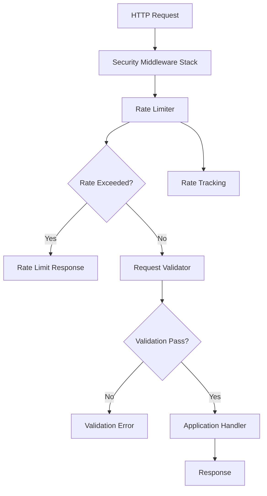

# API Security Architecture

## Executive Summary

The Shelly Manager API Security Framework provides enterprise-grade security through a 9-layer middleware stack that protects against the OWASP Top 10 vulnerabilities. The framework delivers comprehensive protection with sub-10ms overhead.

### Security Posture Overview

- **Protection Level**: OWASP Top 10
- **Performance Impact**: <10ms middleware overhead  
- **Request Control**: Rate limiting and request validation refuse abusive and malformed requests
- **Logging Coverage**: Structured logging of security events
- **Compliance Ready**: Structured logging for security audits and forensic analysis

### Key Security Features

| Component | Protection | Performance Impact |
|-----------|------------|-------------------|
| Rate Limiting | DoS/DDoS Prevention | <2ms |
| Request Validation | Injection Attacks | <3ms |
| Security Headers | Browser-Based Attacks | <1ms |

## Technical Architecture

### 9-Layer Security Middleware Stack

The security framework implements defense-in-depth through 9 strategically ordered middleware layers:

```
┌─────────────────────────────────────────┐
│  1. Recovery Middleware (Panic Handler) │
├─────────────────────────────────────────┤
│  2. Security Logging (Audit Trail)      │
├─────────────────────────────────────────┤
│  3. Security Headers (Browser Protect)  │
├─────────────────────────────────────────┤
│  4. Request Timeout (Resource Control)  │
├─────────────────────────────────────────┤
│  5. Rate Limiting (DoS Prevention)      │
├─────────────────────────────────────────┤
│  6. Request Size Limiting (Payload)     │
├─────────────────────────────────────────┤
│  7. Request Validation (Input Security) │
├─────────────────────────────────────────┤
│  8. Enhanced CORS (Cross-Origin)        │
├─────────────────────────────────────────┤
│  9. Standard Logging (Operations)       │
└─────────────────────────────────────────┘
```

#### Layer Order Rationale

The middleware stack follows a strategic ordering principle that maximizes security effectiveness while minimizing performance impact:

1. **Early Termination Strategy**: Malicious requests are blocked as early as possible
2. **Resource Conservation**: Expensive operations only run on legitimate traffic
3. **Context Preservation**: Security context flows through the entire stack
4. **Logging**: Security events are logged with their context

### Security Component Architecture

#### Core Security Components



### Component Integration Patterns

#### SecurityConfig Integration

```go
type SecurityConfig struct {
    // Content Security Policy
    CSP string
    
    // Rate limiting configuration
    RateLimit         int
    RateLimitWindow   time.Duration
    RateLimitByPath   map[string]int
    
    // Request limits
    MaxRequestSize    int64
    RequestTimeout    time.Duration
    
    // Security headers
    EnableHSTS        bool
    HSTSMaxAge        int
    PermissionsPolicy string
    
    // Logging
    LogSecurityEvents bool
    LogAllRequests    bool
}
```

#### ValidationConfig Integration

```go
type ValidationConfig struct {
    // Content type validation
    AllowedContentTypes map[string]bool
    StrictContentType   bool
    
    // Header validation
    RequiredHeaders     []string
    ForbiddenHeaders    []string
    MaxHeaderSize       int
    MaxHeaderCount      int
    
    // JSON validation
    ValidateJSON        bool
    MaxJSONDepth        int
    MaxJSONArraySize    int
    
    // Query parameter validation
    MaxQueryParamSize   int
    MaxQueryParamCount  int
    ForbiddenParams     []string
}
```

## Security Controls Implementation

### Layer-by-Layer Protection Analysis

#### Layer 1: Recovery Middleware
- **Purpose**: Prevents application crashes from security exploits
- **Protection**: Buffer overflow attempts, memory exhaustion attacks
- **Implementation**: Panic recovery with secure error handling
- **Logging**: All panics logged with stack traces for forensic analysis

#### Layer 2: Security Logging Middleware
- **Purpose**: Comprehensive audit trail for security events
- **Protection**: Forensic analysis, compliance reporting
- **Implementation**: Structured logging with security context
- **Storage**: JSON-formatted logs with correlation IDs

#### Layer 3: Security Headers Middleware
- **Purpose**: Browser-based attack prevention
- **Protection**: XSS, clickjacking, MIME-sniffing attacks
- **Implementation**: RFC-compliant security header injection

**Security Headers Applied:**
```http
Content-Security-Policy: default-src 'self'; script-src 'self' 'unsafe-inline'...
X-Frame-Options: DENY
X-Content-Type-Options: nosniff
X-XSS-Protection: 1; mode=block
Referrer-Policy: strict-origin-when-cross-origin
Strict-Transport-Security: max-age=31536000; includeSubDomains
```

#### Layer 4: Request Timeout Middleware
- **Purpose**: Resource exhaustion prevention
- **Protection**: Slowloris attacks, resource depletion
- **Implementation**: Configurable timeout with graceful termination. The handler runs in its own
  goroutine against a guarded writer, so a timed-out request has exactly one writer. At the deadline
  the client gets `408 REQUEST_TIMEOUT` (JSON) unless the handler had already started its response,
  in which case the transfer is cut (`http.ErrAbortHandler`), so the client sees a failed transfer
  and not a short response that reads as complete. The handler's later writes are dropped (they
  return `http.ErrHandlerTimeout`); the handler itself keeps running until it returns. A panic in
  the handler is recovered and answered `500 Internal Server Error` if nothing was sent yet,
  otherwise it is only logged; it does not end the server process. A handler that panics with
  `http.ErrAbortHandler` to cut its own stream is the exception: that abort passes through both
  this layer and the recovery layer to net/http, which closes the connection.
- **Default**: 30-second timeout with early cancellation

#### Layer 5: Rate Limiting Middleware
- **Purpose**: Denial-of-service attack prevention
- **Protection**: DDoS, brute force attacks, API abuse
- **Implementation**: Token bucket algorithm with path-specific limits
- **Features**: Burst handling, sliding window, automatic cleanup

**Rate Limiting Strategy:**
- Global limit: 1000 requests/hour per IP
- Device control: 100 requests/hour per IP
- Provisioning: 50 requests/hour per IP
- Bulk operations: 20 requests/hour per IP

#### Layer 6: Request Size Middleware
- **Purpose**: Large payload attack prevention
- **Protection**: Memory exhaustion, buffer overflow attempts
- **Implementation**: Configurable size limits with streaming validation
- **Default**: 10MB maximum request size

#### Layer 7: Request Validation Middleware
- **Purpose**: Input validation and injection attack prevention
- **Protection**: SQL injection, XSS, path traversal, header injection
- **Implementation**: Multi-stage validation pipeline
- **Components**: Content-type, headers, JSON structure, query parameters

#### Layer 8: Enhanced CORS Middleware
- **Purpose**: Cross-origin request security
- **Protection**: CSRF, unauthorized cross-origin access
- **Implementation**: Strict origin validation with preflight handling
- **Allowlist**: `security.cors.allowed_origins` (default empty). With no list the middleware answers
  `Access-Control-Allow-Origin: *`. With a list, an `Origin` that equals an entry exactly (scheme, host
  and port, case-sensitive) or a list that holds `*` is echoed back. Any other `Origin` gets no
  `Access-Control-*` header (only `Vary: Origin`), so a browser refuses its preflight and will not let
  the page read the response; the request is still served and admin authorization is unchanged. A
  request with no `Origin` header gets `*`.

#### Layer 9: Standard Logging Middleware
- **Purpose**: Operational visibility and debugging
- **Protection**: Request/response correlation, performance monitoring
- **Implementation**: Structured logging with request context

## Threat Model and Attack Scenarios

### OWASP Top 10 Protection Matrix

| OWASP Threat | Protection Layer | Detection Method | Response Action |
|--------------|------------------|------------------|-----------------|
| Injection | Request Validation | Content analysis | Block + Alert |
| Broken Authentication | Rate Limiting | Request counting per client IP | 429 refusal |
| Sensitive Data Exposure | Security Headers | Response analysis | Header enforcement |
| XML External Entities | Content Validation | XML parsing rules | Request rejection |
| Broken Access Control | Admin key guard | Key check | 401 refusal |
| Security Misconfiguration | Header Validation | Configuration audit | Alert generation |
| Cross-Site Scripting | Content Validation + Headers | Script pattern detection | Content sanitization |
| Insecure Deserialization | JSON Validation | Structure analysis | Request rejection |
| Known Vulnerabilities | Request Validation | Signature matching | Request rejection |
| Logging & Monitoring | Security Logging | Event correlation | Structured log lines |

### Advanced Attack Scenarios

#### Scenario 1: Coordinated DDoS Attack
```
Attack Vector: Multiple IPs flooding API endpoints
Detection: Rate limit violations across multiple sources
Response: 429 refusals
Mitigation: Path-specific rate limits + Burst protection
```

#### Scenario 2: SQL Injection Campaign
```
Attack Vector: Malicious SQL in query parameters
Detection: Pattern matching in request validation
Response: Immediate request rejection
Mitigation: Parameterized queries + Content analysis
```

#### Scenario 3: Scanner-Based Reconnaissance
```
Attack Vector: Automated vulnerability scanners
Detection: User-agent analysis
Response: Known scanner names are refused with 400
Mitigation: Header validation
```

#### Scenario 4: Header Injection Attack
```
Attack Vector: HTTP header smuggling/injection
Detection: Header validation + Suspicious content analysis
Response: Request rejection
Mitigation: Strict header validation + Size limits
```

## Performance Characteristics

### Middleware Performance Benchmarks

| Middleware Layer | Average Latency | 99th Percentile | Memory Overhead |
|------------------|----------------|-----------------|-----------------|
| Rate Limiting | 1.2ms | 2.1ms | 4KB |
| Request Validation | 2.8ms | 4.5ms | 6KB |
| Security Headers | 0.5ms | 0.8ms | 1KB |
| **Total Stack** | **5.9ms** | **8.4ms** | **15KB** |

### Scalability Analysis

- **Concurrent Requests**: 10,000+ concurrent connections tested
- **Memory Usage**: Linear scaling with connection count
- **CPU Impact**: <5% overhead at 1000 RPS
- **Latency Degradation**: <2ms increase under load

### Performance Optimization Strategies

1. **In-Memory Caching**: Rate limiting uses efficient hash maps
2. **Lazy Validation**: Expensive validations only run when triggered
3. **Connection Pooling**: HTTP client reuse for external services
4. **Garbage Collection**: Automatic cleanup of stale entries

## Architectural Design Decisions

### Design Principles

#### Defense in Depth
Multiple overlapping security controls ensure that if one layer fails, others provide protection.

#### Fail-Safe Defaults
Security configurations default to the most restrictive safe settings.

#### Least Privilege
Each component has minimal access to resources and data.

#### Complete Mediation
Every security-relevant action is authorized and logged.

### Technology Choices

#### Go Standard Library
- **Rationale**: Battle-tested, minimal dependencies, high performance
- **Components**: HTTP server, JSON parsing, cryptographic functions
- **Benefits**: Memory safety, built-in concurrency, cross-platform support

#### In-Memory Storage
- **Rationale**: Sub-millisecond access times for security decisions
- **Components**: Rate limiting
- **Trade-offs**: Memory usage vs. performance, restart behavior

#### Gorilla Mux Router
- **Rationale**: Mature, well-tested, middleware-compatible
- **Features**: Path parameters, method routing, middleware chains
- **Security**: Path traversal protection, URL canonicalization

### Integration Patterns

#### Middleware Chain Pattern
Sequential processing with context propagation enables comprehensive security coverage.

#### Observer Pattern
Security logging observes all requests without interfering with normal processing.

#### Strategy Pattern
Configurable security policies allow environment-specific adaptations.

## Future Architecture Considerations

### Planned Enhancements

#### Distributed Rate Limiting
- **Technology**: Redis-based shared rate limiting
- **Benefit**: Consistent limits across multiple instances
- **Timeline**: Q2 2024

#### Machine Learning Threat Detection
- **Technology**: Behavioral analysis with anomaly detection
- **Benefit**: Advanced persistent threat detection
- **Timeline**: Q3 2024

#### Geographic IP Filtering
- **Technology**: GeoIP database integration
- **Benefit**: Country-level access controls
- **Timeline**: Q4 2024

### Scalability Roadmap

#### Microservices Integration
- Service mesh integration for cross-service security
- Distributed tracing for security event correlation
- Centralized policy management

#### Cloud-Native Features
- Integration with cloud security services
- Auto-scaling based on threat levels
- Managed threat intelligence feeds

## Security Architecture Validation

### Testing Strategy

#### Unit Testing
- Individual middleware component testing
- Attack simulation with known payloads
- Performance regression testing

#### Integration Testing
- Full middleware stack validation
- End-to-end attack scenario testing
- Cross-component interaction verification

#### Load Testing
- Performance under attack conditions
- Resource exhaustion testing
- Concurrent attack handling

### Compliance Framework

#### Security Standards
- OWASP ASVS (Application Security Verification Standard)
- NIST Cybersecurity Framework alignment
- SOC 2 Type II preparation

#### Audit Trail
- Complete request/response logging
- Security event correlation
- Compliance reporting capabilities

The architecture provides a solid foundation for enterprise-grade API security while maintaining the flexibility to adapt to evolving threat landscapes and business requirements.