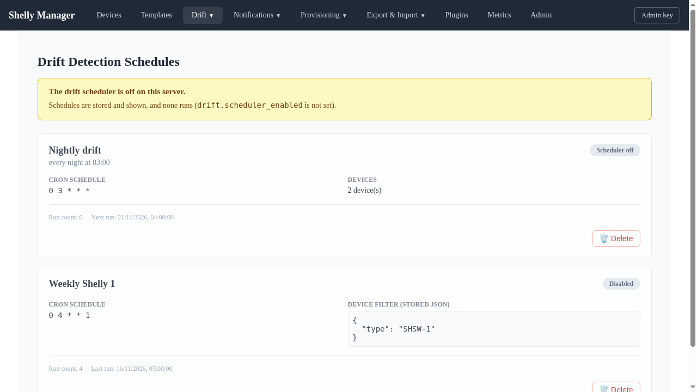
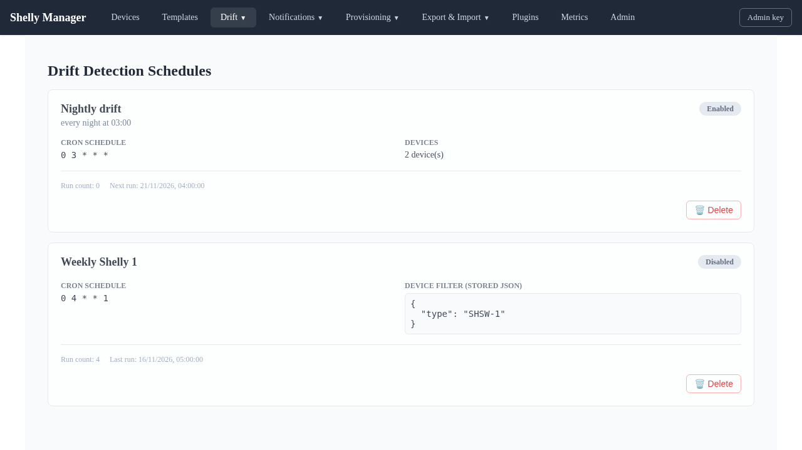
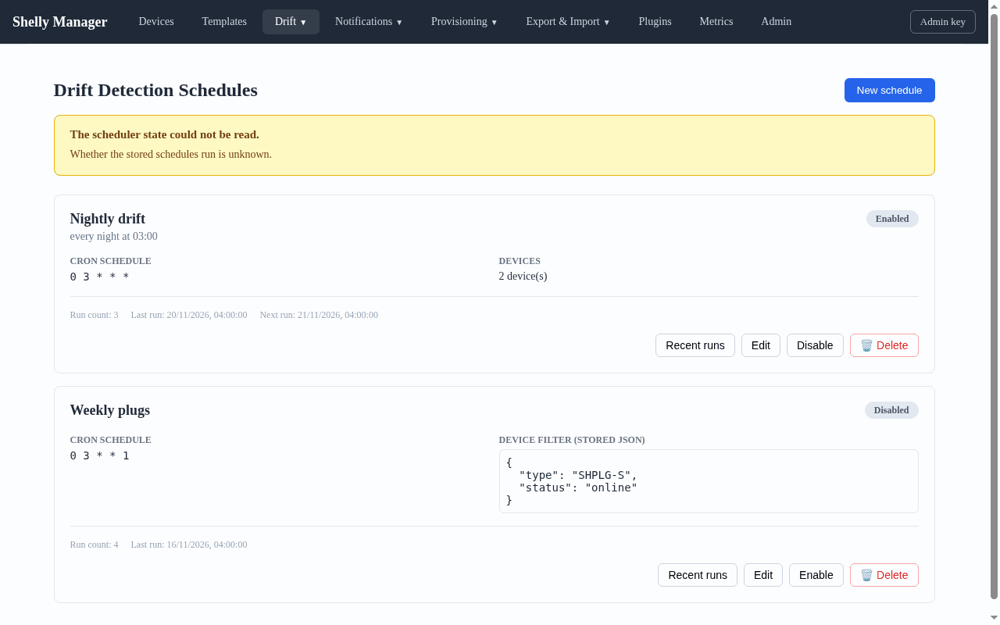
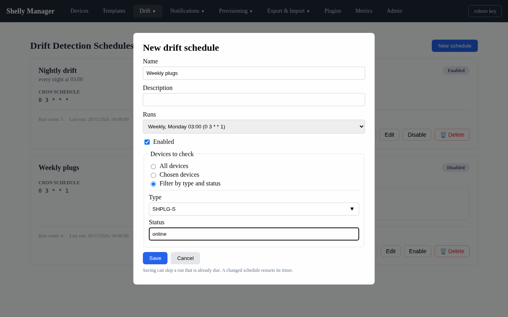
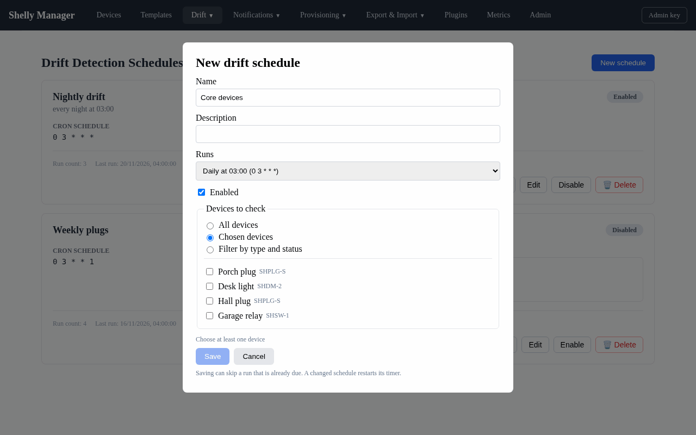
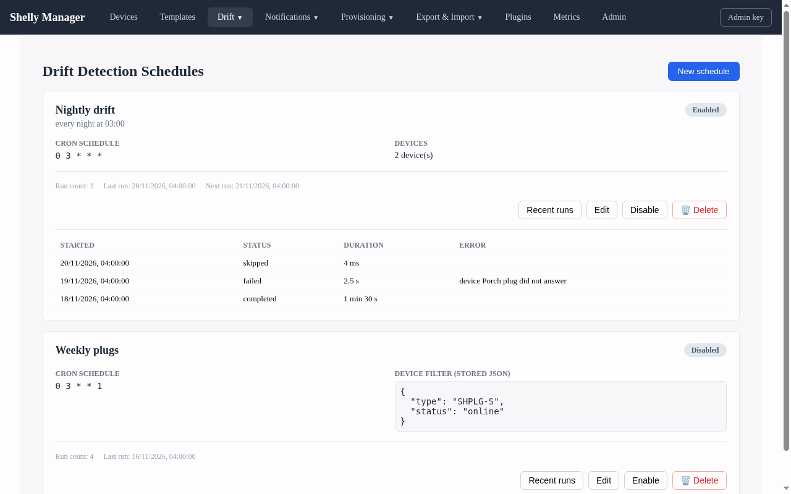

# Frontend Review: Shelly Manager Web Application

**Measured:** 2026-11-19 at commit 13e3038 (`main`); all of section 3 was re-measured at commit 0648bab. This file holds no count of API functions, pages, components or tests: those move with every pull request, so you run the command (section 1 for API coverage, section 2 for the rest) and read the number from it.
**Status:** Every routed page can be reached by clicking from the top bar (section 3).
**Next review:** when a frontend issue from "Open work" merges, or by re-running the commands in this file

A number you quote comes from a command in this file, run at the commit you name. Re-run the command
before you quote a number. Change the date and commit in this header when you refresh the findings in the file.
Tool: ripgrep (`rg` 15.2.0). On this project's host `grep` may be another program; use `rg`.

Preview captures: [registry-backed export](images/registry-export-preview.png)
and [SMA browser import](images/sma-import-preview.png).

---

## 1. API coverage

**Definition.** A function is *defined* when `ui/src/api/*.ts` (tests excluded) has an `export function`
or `export async function` for it. It is *referenced* when its name appears in code (not on a
comment-only line) in another non-test file under `ui/src`. "Referenced" is not "called on a live
path": a match can be an import that is never run, or a same-named local function. A function that is
used only inside its own module counts as unreferenced. A line is skipped as a comment when its first
characters are `//`, `*`, `/*` or `<!--`: code after a `/* ... */` on the same line is missed, and a
bare name inside a multi-line comment whose lines do not start with `*` is counted. A hidden file, and a
file that a `.gitignore` excludes (a `coverage/` directory, a `*.log`), is not read: `rg` skips both, and
the script asks git for its file list. Some exported functions are helpers and not
HTTP calls (`isAbortError`, `toSaveError`, `assertNever`, `computeDailyAggregates`,
`parseMetricsWsMessage`, `isDashboardMessage`).

**The test.** `ui/src/__tests__/api-coverage.test.ts` runs in `make test-ci` and in the CI vitest job. It
measures the tree with `ui/scripts/api-coverage/measure.mjs` (Node only, no `rg`) and compares no figure
with this file. It keeps one fact: the functions with no UI caller equal the short `NO_UI_CALLER` list in
the test, by name, so wiring a function or orphaning one is a visible edit. The four controls below are
test cases. The measurement is the command below, rewritten without `rg`: the two print the same table on
this tree (checked at commit 3b1374d). The command stays here as the definition for a reader without Node.

**The current table.** Run `node ui/scripts/api-coverage/cli.mjs` from the repository root. It prints one
line per module under `ui/src/api` (functions, referenced, and the names with no caller), then a TOTAL
line. The table is not committed here.

**Command** (run from the repository root; save it as a script, it is `bash`):

```bash
cd "${REPO:-.}" || exit 1
api=ui/src/api; src=ui/src
notest=(--glob '!**/*.test.ts' --glob '!**/*.spec.ts' --glob '!**/__tests__/**' --glob '!**/test/**')
comment='^[^:]+:[0-9]+:[[:space:]]*(//|\*|/\*|<!--)'
total=0; used=0
for f in $(rg -l '^export (async )?function ' "${notest[@]}" "$api" | sort); do
  fn=0; fu=0; unused=()
  for name in $(rg -o --no-filename '^export (async )?function \w+' "$f" | awk '{print $NF}'); do
    fn=$((fn + 1))
    if rg -nw "$name" "${notest[@]}" --glob "!$f" "$src" | rg -qv "$comment"; then
      fu=$((fu + 1)); else unused+=("$name"); fi
  done
  printf '%s\t%d\t%d\t%s\n' "$(basename "$f")" "$fn" "$fu" "${unused[*]:-}"
  total=$((total + fn)); used=$((used + fu))
done
printf 'TOTAL\t%d\t%d\n' "$total" "$used"
```

**Controls.** The count is trusted only if these hold. Each was checked at this commit:

- `bulkImport` (used by `components/bulk/BulkOperationsDialog.vue`) counts as referenced.
- `rotateAdminKey` (used by `pages/AdminSettingsPage.vue`) counts as referenced.
- `getBackupResult` (named only in its own module and in a test) counts as unreferenced.
- A fixture tree with a name that appears only in a `//` line, a name only in a `/* */` line, a name only
  in a `*` line, a name only in a `<!--` line, a name only in test files, a name only in its own module
  and a name only as the start of a longer name reports all seven as unreferenced and the used names
  (plain and `async`) as referenced.

This measures what the UI uses, not what the backend offers. It does not count backend routes.
ginsys/shelly-manager#84 asked for the UI side. The February 2026 audit in that issue (48 of 108
functions, 44%) is out of date: it predates the work listed in section 6.

---

## 2. Stack and structure

Versions are the ranges declared in `ui/package.json`, not the installed ones.

| Technology | Declared | Notes |
|------------|----------|-------|
| Vue | ^3.5.45 | Composition API, `<script setup>` |
| TypeScript | ^5.9.3 | `npm run typecheck` is `vue-tsc --noEmit` |
| Vue Router | ^5.5.0 | Routes in `ui/src/router/routes.ts` (`main.ts` builds the router from it), every page lazy-loaded |
| Pinia | ^4.0.3 | State management |
| Vite | ^8.3.8 | Build tool |
| axios | ^1.21.1 | HTTP client in `ui/src/api/client.ts` |
| ECharts | ^6.1.0 | Metrics charts |
| Vitest | ^4.1.4 | Unit tests |
| Playwright | ^1.65.0 | End-to-end tests |
| Quasar | ^2.35.4 | **Declared but never imported in `ui/src`**; only `vite.config.ts` names it, in a chunk rule |

Counts are not committed here: they change with almost every pull request. Run the command for the one
you need (from the repository root):

| What | Command |
|------|---------|
| Routed page components | `fd -e vue . ui/src/pages \| wc -l` |
| Reusable components (excluding tests) | `fd -e vue . ui/src/components \| rg -v __tests__ \| wc -l` |
| Pinia stores (excluding tests) | `fd -e ts . ui/src/stores \| rg -v '\.test\.ts\|__tests__' \| wc -l` |
| Composables | `fd -e ts . ui/src/composables \| rg -v __tests__ \| wc -l` |
| Unit test files / `it`+`test` calls | `fd '\.test\.ts$' ui/src \| wc -l`; `rg --no-filename -c '^\s*(it\|test)\(' ui/src --glob '*.test.ts' \| awk '{s+=$1} END{print s}'` |
| End-to-end spec files / `test` calls | `fd '\.spec\.ts$' ui/tests/e2e \| wc -l`; `rg --no-filename -c '^\s*test\(' ui/tests/e2e --glob '*.spec.ts' \| awk '{s+=$1} END{print s}'` |

The e2e command counts `test(` calls once. Playwright runs each across the browsers its config lists,
so the number of executed scenarios is higher.

---

## 3. Pages and routes

"Linked from" is read from the output of the navigation-target
command below (re-run at commit 0648bab for this section); "none" would mean no nav item and no page
links to that route. The size of a page is `wc -l` of its file, and is not committed here. The top-bar menu entries are written in `ui/src/layouts/MainLayout.vue` as
`to: '/path'` and drawn by `ui/src/components/NavMenu.vue`, so the pattern includes that form.

**Command:**

```bash
rg -n --no-heading -o "(to=\"[^\"]+\"|:to=\"[^\"]+\"|to: '[^']+'|router\.(push|replace)\([^)]*\)|href=\"/[^\"]*\")" ui/src \
  --glob '*.vue' --glob '*.ts' --glob '!**/*.test.ts' --glob '!**/__tests__/**' | sort -u
```

| Route | Page | Linked from |
|-------|------|-------------|
| `/` | Devices | top bar, Device details |
| `/devices/:id` | Device details (status, energy, configuration, capabilities, edit, control) | Devices, Device configuration, Drift reports, Task details |
| `/devices/:id/config` | Device configuration (templates, overrides, apply, verify, last import and create template from it, desired configuration versions and rollback, import history) | Device details, Configuration history |
| `/devices/:id/config/history` | Configuration history (list and view, no restore: ginsys/shelly-manager#775) | Device details |
| `/templates` | Configuration templates | top bar, Template detail |
| `/templates/common-settings` | Common settings (compare the imports of several devices, save what they share as a template) | Templates |
| `/templates/:id` | Template detail | Templates |
| `/drift/schedules` | Drift schedules (create, edit, enable or disable, delete, recent runs; see section 5) | top bar (Drift) |
| `/drift/reports` | Drift reports | top bar (Drift) |
| `/drift/trends` | Drift trends | top bar (Drift) |
| `/export/backup` | Backup management | top bar (Export & Import) |
| `/export/gitops` | GitOps export | top bar (Export & Import) |
| `/export/history` | Export history | top bar (Export & Import) |
| `/export/:id` | Export result | Export history |
| `/import/history` | Import history | top bar (Export & Import) |
| `/import/:id` | Import result | Import history |
| `/plugins` | Plugin management (read-only) | top bar |
| `/dashboard` | Metrics dashboard | top bar |
| `/admin` | Admin settings (admin key rotation) | top bar |
| `/notifications/channels` | Notification channels | top bar (Notifications), Channel detail |
| `/notifications/channels/:id` | Channel detail | Channels |
| `/notifications/rules` | Notification rules | top bar (Notifications) |
| `/notifications/history` | Notification history | top bar (Notifications) |
| `/provisioning` | Provisioning dashboard | top bar (Provisioning) |
| `/provisioning/tasks` | Provisioning tasks | top bar (Provisioning), Provisioning dashboard, Task details |
| `/provisioning/tasks/:id` | Task details | Tasks, dashboard |
| `/provisioning/agents` | Provisioning agents | top bar (Provisioning), Provisioning dashboard |

Any other path falls through to the Devices page.

### Pages a user cannot reach by clicking

None. A page is reachable when a chain of links leads to it from the top bar. The top bar links
Devices, Templates, Plugins, Metrics and Admin, and has four menus: Drift (schedules, reports,
trends), Notifications (channels, rules, history), Provisioning (dashboard, tasks, agents) and
Export & Import (backup, GitOps, export history, import history). Every other route (`:id` detail
pages and the device configuration pages) is linked from its list page. This was fixed by
ginsys/shelly-manager#645 (ginsys/shelly-manager#641); a mocked end-to-end spec
(`ui/tests/e2e/nav-reachability.spec.ts`) walks the links.

Linked is not the same as working: the export and import detail pages answer from the
engine's memory, or else from the stored history record, which lacks the warnings of an export and the changes and warnings of an import (ginsys/shelly-manager#647). Both pages show the main fields
of a result (status, created time, duration, errors, warnings, and for an import the changes by
type, never their values; ginsys/shelly-manager#139). They do not show the export `output_path`,
`webhook_sent` and `metadata`, nor the import `metadata`. The export page downloads the file
through the API client, because a plain link sends no admin key; an import has no download because the
API has no such route. The import history page shows the statistics, and both history pages show the
error of a failed statistics request instead of zeros. The routes live in `ui/src/router/routes.ts`, and the unit
test `ui/src/__tests__/route-reachability.test.ts` fails when a route with no `:` in its path has no top-bar entry and
no link from another page (ginsys/shelly-manager#646). It does not check the pages with a path parameter (the `:id`
pages, which include the two device configuration pages); the Playwright spec walks those. The unit test
reads source text, not the rendered page: it ignores comments and `<style>` blocks, but a link in a file that no
page imports still counts. The Playwright spec is what proves the links are rendered.

---

## 4. Components, stores and utilities

- **Components** (`ui/src/components`): the directories `backup/`, `bulk/` (the bulk dialog and its apply
  form), `charts/`, `config/`, `devices/`, `gitops/`, `plugin/`, `provisioning/` and `shared/`, and the
  top-level files `DataTable`, `FilterBar`, `PaginationBar`, `ExportPreviewForm`, `ImportPreviewForm`,
  `GitOpsConfigForm`, `PluginDetailsView` and `PluginSchemaViewer`.
- **Stores** (`ui/src/stores`): devices, deviceConfigNew, drift, export, import, metrics,
  notifications, plugin, provisioning, templates, typedConfig.
- **Composables:** `useError` (normalises an error into a message, suggestions and a retry flag),
  `useNotice` (`usePageError`: the same, but a failure the page cannot show goes to the app notice
  that `MainLayout` mounts; `useLateFailure` and `useLateResult` for what a page shows itself while
  it is open) and `useWebSocket`.
- **Utilities** (`ui/src/utils`): SMA parser and generator, strict JSON, JCS and SHA-256 helpers for
  the SMA integrity check, plugin schema helpers, config form helpers, a version banner.

---

## 5. Features whose state is not obvious

- **Drift schedules run only when the scheduler is on, and the page now says whether it is.** The
  scheduler is off by default (`drift.scheduler_enabled`). The create, update, toggle and run-list
  routes work (ginsys/shelly-manager#279). The page reads `GET /api/v1/config/drift-scheduler` and,
  with the scheduler off, shows a banner and the badge "Scheduler off" on an enabled schedule; a
  disabled schedule reads "Disabled", and a failed read of the state shows its own banner and never
  claims the scheduler is off. The state is that of the one server that answers, so replicas
  configured differently differ. The page also creates and edits a schedule (a form with a cron
  preset or a custom spec, and one of three device choices: all devices, chosen devices, or a type
  and status filter), enables or disables it, deletes it, and lists its recent runs when a card is
  opened (started, status, duration, error; newest first). The form sends at most one of the device
  list and the filter (neither for all devices), and waits with Save until a chosen list or a filter has something in it.
  Only a new schedule has an Enabled box: an edit sends no `enabled`, so a save never undoes the card's Enable or Disable. The
  server checks the cron spec, the devices and the filter, and its refusal is shown as written.
  Saving can skip a run that is already due, and a changed schedule restarts its timer. The list
  route answers every schedule at once with no paging, so the page has no pager. Not in the UI: a
  view of one run's results (the server has no route for it).

  
  
  
  
  
  

- **Rolling the desired configuration back** (ginsys/shelly-manager#775). The "Desired configuration versions"
  card on the device configuration page (`components/config/DesiredRollbackCard.vue`) lists the versions that
  `GET /devices/{id}/desired-config/history` returns and rolls one back with `POST
  /devices/{id}/config/new/rollback`. The confirm shows the difference with the current desired configuration
  (`utils/desiredDiff.ts`; secrets are not compared), the templates that are detached and the way back. A 409
  with paths keeps the dialog open with one input per path, and the typed secrets live in that dialog only.
  Roll back is off while the overrides editor is open. No device is contacted: the operator applies afterwards. The History card below it lists imports, not these versions.
- **An open overrides edit survives a refresh** (ginsys/shelly-manager#855). The page reloads the overrides into
  the editor only while the editor is closed. Text in the JSON view that does not parse yet is still lost on a
  refresh, because the page shows "Loading..." in place of the editor while it loads (ginsys/shelly-manager#858). If the saved overrides change under an open edit (a rollback does
  this), the edit is kept, a notice says so, and Save is off until Cancel loads the saved overrides. It sees a
  change this page has read: one made from another browser, or one whose refresh failed, is not seen.
- **Drift compares with the desired configuration**, the one apply writes and verify reads, and no
  longer with the stored import record (ginsys/shelly-manager#606). A device with no desired
  configuration cannot be checked: the drift route answers 404 and a bulk run marks it skipped.
- **Plugins are read-only.** The plugin UI lists plugins, shows their schema and details. There is no
  backend model for stored plugin configuration or a plugin test, so the config, test and toggle
  calls were removed (ginsys/shelly-manager#264). The product model is
  ginsys/shelly-manager#290.

  

- **A list of channels (relays) shows and edits as fields, not as JSON** (ginsys/shelly-manager#765).
  The device configuration view shows a nested value by its shape: an object as fields, a list of
  objects as one group per item, a list of plain values as a comma list. The override editor shows one
  fieldset per relay, keyed by the relay `id` as the server merges lists by id, and an override holds
  only the relays and fields changed. It offers no add or remove: the schema fixes no length. A list
  whose items share an id stays one JSON box. A save the server refuses shows each field error under
  its field. The template detail page is unchanged.
- **Export and import.** Export preview reads the live plugin registry and the backend schemas;
  browser import preview is SMA-only and registry-gated; SMA uses strict `2026.1`
  (ginsys/shelly-manager#268). A non-preview `POST /import` restores devices, templates and
  discovered devices in one transaction (ginsys/shelly-manager#284); the browser has no restore UI
  for it. A stored backup can be checked from Backup Management (`POST /import/restore-preview`,
  the file's presence and size only), then staged (`POST /import/restore`); the server applies a
  staged restore at its next start. The page shows the staged restore with Cancel (`DELETE`) and the
  last result (`GET /import/restore`); a 501 on a database that is not SQLite keeps the check and
  withholds staging (ginsys/shelly-manager#748). Export to the device was retired in favour of apply (ginsys/shelly-manager#604).
- **Bulk operations** work from the devices page: a select column, a select-all for the visible rows
  and a Bulk Operations button that opens the dialog for exactly the picked ids
  (ginsys/shelly-manager#136). The selection is kept by device id across page changes. Opening the
  dialog checks the ticked devices that are not on the loaded page with one unpaged list request
  (`page_size` 0) and drops those the server no longer lists, with one line under the selection
  count. A failed request keeps every device. Ticked devices on the loaded page are not asked about:
  the loaded rows are the truth for them (ginsys/shelly-manager#618). A fourth card, Download
  Configuration, saves the desired configuration of the picked devices as one JSON file through
  `POST /api/v1/config/bulk-download`. It reads the database and contacts no device, every secret in the
  file is masked, and the dialog says so and never shows a configuration itself. A device that
  cannot be read is listed with the reason. The route refuses more than 200 devices and the dialog shows
  its text (ginsys/shelly-manager#595). A fifth card, Apply Configuration, is the only bulk operation
  that writes devices (`POST /api/v1/config/bulk-apply`, `ui/src/api/bulkApply.ts` and
  `components/bulk/BulkApplyForm.vue`). The operator types one partial configuration as JSON
  (`null` removes an override, a secret sent as `********` keeps the stored one) and reviews the exact
  devices and the exact JSON in a confirmation before anything is sent; Apply sends what was
  confirmed. The dialog takes at most 10 devices, forgets the typed text when an answer arrives, when the
  outcome is unknown or when the window closes, and offers no second apply while an earlier call is
  still running (closing the window does not stop it). The result says per device what was written and whether the new settings are
  stored and the device stays pending. Only a refusal the route gives before it touches a device (400,
  401, 403, 413, 415, 429) is reported as "nothing was written"; any other outcome (a 408, a 5xx, no
  answer) is reported as unknown, with "check each device before sending again". The browser waits 310
  s, just over the route's own 5 minute deadline (ginsys/shelly-manager#725). Not in the dialog:
  a tag, group or template as the target, and a dry run (ginsys/shelly-manager#594).
- **Devices list refresh:** a Refresh button and an `R` shortcut reload the list; the rows stay on
  screen (dimmed, `aria-busy`) while it runs, and only the first load shows the loading text. The
  selection is kept, and a refresh copies the new name and address into ticked devices that are on
  the page. A list answer that a newer load has overtaken is dropped
  (ginsys/shelly-manager#80, ginsys/shelly-manager#618).
- **Device login:** the device page has a Device Login card for the device's own credentials
  (`PUT /devices/{id}/config/auth`).
- **Metrics** use a WebSocket stream with a REST fallback; the message contract is typed in
  `ui/src/api/metricsContract.ts`. The REST client reuses those types for the dashboard,
  notification and resolution answers; `ui/src/api/metrics.ts` types the security answer and the
  test-alert answer from their Go structs. The dashboard page loads its four REST panels with
  `Promise.allSettled`, so one failing endpoint empties only its own panel.
- **Admin key:** `ui/src/api/client.ts` reads the admin key from `VITE_ADMIN_KEY` (set at build
  time) or `window.__ADMIN_KEY__`. A production build has no supported way to get it today
  (ginsys/shelly-manager#619).
- **Admin key rotation:** the `/admin` page (`ui/src/pages/AdminSettingsPage.vue`) takes the new key
  in two password fields and rotates only when both match. A key that starts or ends with a space is
  refused on the page, because the key travels in a header that drops such spaces and the server
  would store it as typed. After a rotation `rotateAdminKey` (`ui/src/api/admin.ts`) stores the new key as
  the entered key, so this tab sends it at once, ahead of `VITE_ADMIN_KEY` and `window.__ADMIN_KEY__`.
  The page says the change is in memory only: a server restart brings back the configured key, and
  other clients keep failing until they are given the new key. The server has no rule about what
  counts as a usable key, and making a rotation durable needs a storage decision that no ticket
  carries yet.

---

## 6. Phase 7 API integration issues (ginsys/shelly-manager#128 to ginsys/shelly-manager#139)

State read from GitHub on 2026-11-19 with `gh api graphql` (`closedByPullRequestsReferences`).

| Issue | Subject | State | Closed by |
|-------|---------|-------|-----------|
| ginsys/shelly-manager#128 | Provisioning API | closed, completed 2026-04-14 | ginsys/shelly-manager#191 |
| ginsys/shelly-manager#129 | Drift detection API | closed, completed 2026-04-14 | ginsys/shelly-manager#187 |
| ginsys/shelly-manager#130 | Device config API | closed, completed 2026-04-13 | ginsys/shelly-manager#189 |
| ginsys/shelly-manager#131 | Export system API | closed, not planned 2026-07-21 | no pull request |
| ginsys/shelly-manager#132 | Device management CRUD | closed, completed 2026-04-13 | ginsys/shelly-manager#182 |
| ginsys/shelly-manager#133 | Notification API | closed, not planned 2026-07-21 | no pull request |
| ginsys/shelly-manager#134 | Metrics REST response-shape alignment | closed, completed 2026-11-19 | ginsys/shelly-manager#691 |
| ginsys/shelly-manager#135 | Typed config | closed, not planned 2026-07-21 | no pull request |
| ginsys/shelly-manager#136 | Bulk operations (selection and dialog) | closed, completed 2026-11-18 | ginsys/shelly-manager#613 |
| ginsys/shelly-manager#137 | Capability-specific config UI | closed, completed 2026-11-12 | ginsys/shelly-manager#499 |
| ginsys/shelly-manager#138 | Admin key rotation | closed, completed 2026-07-21 | no pull request recorded |
| ginsys/shelly-manager#139 | Polish export/import detail pages | closed, completed 2026-11-19 | the pull request that carries this line |

---

## 7. Open work

Open frontend issues (label `area: frontend`) at 2026-11-19:

| Issue | Subject |
|-------|---------|
| ginsys/shelly-manager#619 | A production build has no supported way to get the admin key (pull requests in flight) |
| ginsys/shelly-manager#290 | Design the plugin configuration model (plugins stay read-only until then) |

ginsys/shelly-manager#250 (the notification pages and the notification API disagreed) was fixed after
that date. It left one frontend issue, found on 2026-11-20: ginsys/shelly-manager#744, a notification
channel could not be created from the page because the create form had no config fields. That is fixed: the
form has the fields of each type, and a refused config shows the server's reason. Editing a channel's config
from the channel page (ginsys/shelly-manager#783) is fixed too: the page has an Edit mode with the same
fields, and a stored credential (the URL, the headers, the secret) is kept or replaced as the user chooses.
What is left is the channel's name, description and type, which the page cannot change, and the config keys
the form does not show (a template, a timeout, retries, a Slack icon), which a save keeps as they are.

Also parked, not frontend-labelled: ginsys/shelly-manager#249 (export/import routes the frontend
calls that the backend does not have). Parked issues are not next work.

---

## 8. Technical debt

Found by reading the code at this commit; not a plan.

1. **The end-to-end reachability spec keeps its own path list** (section 3). The unit test reads the
   route table (`ui/src/router/routes.ts`); the Playwright spec does not, so a new `:id` page is
   checked only if someone adds it to the spec.
2. **Quasar is a dependency nothing imports** (section 2).
3. **Large pages:** `BackupManagementPage.vue`, `MetricsDashboardPage.vue` and
   `PluginManagementPage.vue`. Read the size with `wc -l ui/src/pages/*.vue | sort -n`.
4. **One shared form, three forms:** only `ExportPreviewForm` uses `shared/SchemaForm.vue`;
   `ImportPreviewForm` and `GitOpsConfigForm` do not.
5. **No generated API client.** The API functions measured in section 1 are written by hand. The coverage
   is measured by `ui/src/__tests__/api-coverage.test.ts` (ginsys/shelly-manager#643), which also fails when a
   function gains or loses its last UI caller without `NO_UI_CALLER` changing; it does not check that a
   referenced function is called on a live path, and no figure of it is committed.
6. **No page calls `alert(` any more** (ginsys/shelly-manager#614), and
   `ui/src/pages/__tests__/noAlertPages.test.ts` fails if one does. A store action (add, modify,
   remove, cancel, resolve, refresh, bulk, create, update) only rethrows its failure and sets no
   error field, so the store's error field (`channelsError`, `tasksError`, `error` and the like)
   stays the failure of the last list load, and a failed delete or create no longer blanks the table
   (ginsys/shelly-manager#701). The page that acted shows the failure of its own action: in an error
   panel above the list (`usePageError`), or inside the dialog that stays open (a string the dialog
   holds). A dialog closed with Cancel while its request runs hands the failure to the page panel
   (or to the app notice when another dialog covers the panel), so a failure is never left in a
   dialog nobody sees. A page that calls the API itself (the metrics dashboard, the template detail) shows a
   failure in an error panel, and a success in one status line. A failure that arrives after the
   user left the page, or while a dialog covers the page panel, shows in one app notice
   (ginsys/shelly-manager#648): such a page takes its error from `usePageError` instead of
   `useError`, and a dialog calls `useLateFailure`, which shows the failure there only when the page
   is already gone or the dialog is covered. The result of an Apply that the device configuration page
   shows in a card goes to the same notice once the page is gone (`useLateResult`), as a notice for a
   success and as a warning for an unconfirmed apply or one that completed with errors
   (ginsys/shelly-manager#660). While an action runs, its store raises the same `loading` flag as a
   list load, so the table shows "Loading…" until the action ends. The metrics store's
   `fetchStatus()` returns whether the status was read, so the page can say a control worked and the
   status could not be refreshed. The guard reads pages only: a component or a composable could still
   call `alert(`. Command:
   `rg -n '\balert\(' ui/src --glob '*.vue' --glob '*.ts' --glob '!**/*.test.ts' --glob '!**/__tests__/**'`.
