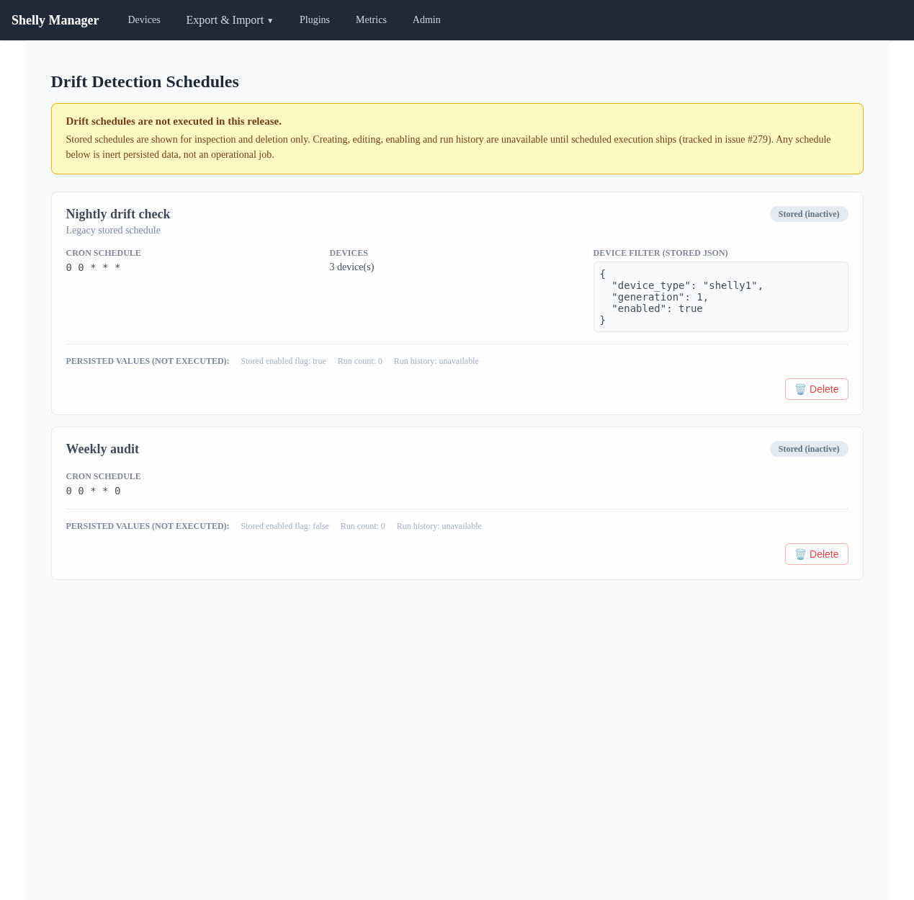
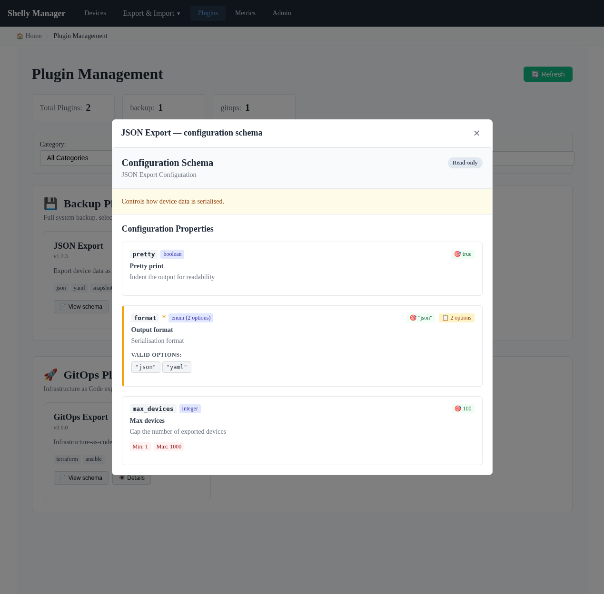

# Frontend Review: Shelly Manager Web Application

**Measured:** 2026-11-19 at commit 13e3038 (`main`)
**Status:** 113 of 117 exported API functions are referenced by the UI (97%). Fifteen of the 26 routed pages cannot be reached from the top bar by clicking.
**Next review:** when a frontend issue from "Open work" merges, or by re-running the commands in this file

Every number below comes from a command in this file, run at the commit above. Re-run the command
before you quote a number, and change the date and commit in this header when you refresh the file.
Tool: ripgrep (`rg` 15.2.0). On this project's host `grep` may be another program; use `rg`.

Preview captures: [registry-backed export](images/registry-export-preview.png)
and [SMA browser import](images/sma-import-preview.png).

---

## 1. API coverage

**Definition.** A function is *defined* when `ui/src/api/*.ts` (tests excluded) has an `export function`
or `export async function` for it. It is *referenced* when its name appears in code (not on a
comment-only line) in another non-test file under `ui/src`. "Referenced" is not "called on a live
path": a match can be an import that is never run, or a same-named local function. A function that is
used only inside its own module counts as unreferenced. A line is skipped as a comment when its first
characters are `//`, `*`, `/*` or `<!--`: code after a `/* ... */` on the same line is missed, and a
bare name inside a multi-line comment whose lines do not start with `*` is counted. Some exported functions are helpers and not
HTTP calls (`isAbortError`, `toSaveError`, `assertNever`, `computeDailyAggregates`,
`parseMetricsWsMessage`, `isDashboardMessage`).

**Command** (run from the repository root; save it as a script, it is `bash`):

```bash
cd "${REPO:-.}" || exit 1
api=ui/src/api; src=ui/src
notest=(--glob '!**/*.test.ts' --glob '!**/*.spec.ts' --glob '!**/__tests__/**' --glob '!**/test/**')
comment='^[^:]+:[0-9]+:[[:space:]]*(//|\*|/\*|<!--)'
total=0; used=0
for f in $(rg -l '^export (async )?function ' "${notest[@]}" "$api" | sort); do
  fn=0; fu=0; unused=()
  for name in $(rg -o --no-filename '^export (async )?function \w+' "$f" | awk '{print $NF}'); do
    fn=$((fn + 1))
    if rg -nw "$name" "${notest[@]}" --glob "!$f" "$src" | rg -qv "$comment"; then
      fu=$((fu + 1)); else unused+=("$name"); fi
  done
  printf '%s\t%d\t%d\t%s\n' "$(basename "$f")" "$fn" "$fu" "${unused[*]:-}"
  total=$((total + fn)); used=$((used + fu))
done
printf 'TOTAL\t%d\t%d\n' "$total" "$used"
```

**Controls.** The count is trusted only if these hold. Each was checked at this commit:

- `bulkImport` (used by `components/bulk/BulkOperationsDialog.vue`) counts as referenced.
- `rotateAdminKey` (used by `pages/AdminSettingsPage.vue`) counts as referenced.
- `getBackupResult` (named only in its own module and in a test) counts as unreferenced.
- A fixture tree with a name that appears only in a `//` line, a name only in a `/* */` line and a name
  only in a test file reports all three as unreferenced and the one used name as referenced.

**Result at 13e3038:**

| Module | Functions | Referenced | Unreferenced |
|--------|-----------|------------|--------------|
| `admin.ts` | 1 | 1 | |
| `bulk.ts` | 4 | 4 | |
| `configNew.ts` (per-device templates, overrides, desired config, apply, verify) | 12 | 12 | |
| `deviceConfig.ts` | 4 | 4 | |
| `devices.ts` | 10 | 10 | |
| `drift.ts` | 8 | 8 | |
| `export.ts` | 27 | 25 | `getBackupResult`, `getRestoreResult` |
| `import.ts` | 4 | 4 | |
| `metrics.ts` | 14 | 14 | |
| `metricsContract.ts`, `metricsMessages.ts` | 3 | 2 | `isDashboardMessage` |
| `notification.ts` | 9 | 9 | |
| `plugin.ts` | 4 | 3 | `getPlugin` |
| `provisioning.ts` | 7 | 7 | |
| `templates.ts` | 8 | 8 | |
| `typedConfig.ts` | 2 | 2 | |
| **Total** | **117** | **113** | **4** |

This measures what the UI uses, not what the backend offers. It does not count backend routes.
ginsys/shelly-manager#84 asked for the UI side. The February 2026 audit in that issue (48 of 108
functions, 44%) is out of date: it predates the work listed in section 6.

---

## 2. Stack and structure

Versions are the ranges declared in `ui/package.json`, not the installed ones.

| Technology | Declared | Notes |
|------------|----------|-------|
| Vue | ^3.5.45 | Composition API, `<script setup>` |
| TypeScript | ^5.9.3 | `npm run typecheck` is `vue-tsc --noEmit` |
| Vue Router | ^5.5.0 | Routes in `ui/src/main.ts`, every page lazy-loaded |
| Pinia | ^4.0.3 | State management |
| Vite | ^8.3.8 | Build tool |
| axios | ^1.21.1 | HTTP client in `ui/src/api/client.ts` |
| ECharts | ^6.1.0 | Metrics charts |
| Vitest | ^4.1.4 | Unit tests |
| Playwright | ^1.65.0 | End-to-end tests |
| Quasar | ^2.35.4 | **Declared but never imported in `ui/src`**; only `vite.config.ts` names it, in a chunk rule |

Counts (commands, from the repository root):

| What | Count | Command |
|------|-------|---------|
| Routed page components | 26 | `fd -e vue . ui/src/pages \| wc -l` |
| Reusable components (excluding tests) | 38 | `fd -e vue . ui/src/components \| rg -v __tests__ \| wc -l` |
| Pinia stores (excluding tests) | 11 | `fd -e ts . ui/src/stores \| rg -v '\.test\.ts\|__tests__' \| wc -l` |
| Composables | 2 | `fd -e ts . ui/src/composables \| rg -v __tests__ \| wc -l` |
| Unit test files / `it`+`test` calls | 63 / 616 | `fd '\.test\.ts$' ui/src \| wc -l`; `rg --no-filename -c '^\s*(it\|test)\(' ui/src --glob '*.test.ts' \| awk '{s+=$1} END{print s}'` |
| End-to-end spec files / `test` calls | 18 / 49 | `fd '\.spec\.ts$' ui/tests/e2e \| wc -l`; `rg --no-filename -c '^\s*test\(' ui/tests/e2e --glob '*.spec.ts' \| awk '{s+=$1} END{print s}'` |

The e2e figure counts `test(` calls once. Playwright runs each across the browsers its config lists,
so the number of executed scenarios is higher.

---

## 3. Pages and routes

Lines are `wc -l` of the page file. "Linked from" is read from the output of the navigation-target
command below; "none" means no nav item and no page links to that route.

**Command:**

```bash
rg -n --no-heading -o '(to="[^"]+"|:to="[^"]+"|router\.(push|replace)\([^)]*\)|href="/[^"]*")' ui/src \
  --glob '*.vue' --glob '*.ts' --glob '!**/*.test.ts' --glob '!**/__tests__/**' | sort -u
```

| Route | Page | Lines | Linked from |
|-------|------|-------|-------------|
| `/` | Devices | 388 | top bar, Device details |
| `/devices/:id` | Device details (status, energy, configuration, capabilities, edit, control) | 452 | Devices, Device configuration, Drift reports, Task details |
| `/devices/:id/config` | Device configuration (templates, overrides, apply, verify) | 493 | Device details, Configuration history |
| `/devices/:id/config/history` | Configuration history | 143 | Device details |
| `/templates` | Configuration templates | 395 | its own detail page only |
| `/templates/:id` | Template detail | 375 | Templates |
| `/drift/schedules` | Drift schedules (inspect and delete only, see section 5) | 357 | **none** |
| `/drift/reports` | Drift reports | 519 | **none** |
| `/drift/trends` | Drift trends | 517 | **none** |
| `/export/backup` | Backup management | 856 | top bar (Export & Import) |
| `/export/gitops` | GitOps export | 577 | top bar (Export & Import) |
| `/export/history` | Export history | 70 | top bar (Export & Import) |
| `/export/:id` | Export result | 43 | **none** |
| `/import/history` | Import history | 57 | top bar (Export & Import) |
| `/import/:id` | Import result | 34 | **none** |
| `/plugins` | Plugin management (read-only) | 565 | top bar |
| `/dashboard` | Metrics dashboard | 649 | top bar |
| `/admin` | Admin settings (admin key rotation) | 45 | top bar |
| `/notifications/channels` | Notification channels | 197 | its own detail page only |
| `/notifications/channels/:id` | Channel detail | 126 | Channels |
| `/notifications/rules` | Notification rules | 199 | **none** |
| `/notifications/history` | Notification history | 156 | **none** |
| `/provisioning` | Provisioning dashboard | 86 | **none** |
| `/provisioning/tasks` | Provisioning tasks | 92 | Provisioning dashboard, Task details |
| `/provisioning/tasks/:id` | Task details | 124 | Tasks, dashboard |
| `/provisioning/agents` | Provisioning agents | 95 | Provisioning dashboard |

Any other path falls through to the Devices page.

### Pages a user cannot reach by clicking

A page is reachable when a chain of links leads to it from the top bar. The top bar links Devices,
Export & Import (backup, GitOps, export history, import history), Plugins, Metrics and Admin.
Eight routes have no inbound link at all: `/drift/schedules`, `/drift/reports`, `/drift/trends`,
`/export/:id`, `/import/:id`, `/notifications/rules`, `/notifications/history` and `/provisioning`.
Two more, `/templates` and `/notifications/channels`, are linked only from their own detail pages,
and five pages are linked only from pages in that unreachable set (`/templates/:id`,
`/notifications/channels/:id`, `/provisioning/tasks`, `/provisioning/tasks/:id`,
`/provisioning/agents`). So 15 of the 26 pages work only when the URL is typed. The export and
import detail pages are tracked in ginsys/shelly-manager#139; the whole navigation gap is
ginsys/shelly-manager#641.

---

## 4. Components, stores and utilities

- **Components** (`ui/src/components`): `backup/` (7), `bulk/` (the bulk dialog, 1), `charts/` (2),
  `config/` (3), `devices/` (2), `gitops/` (5), `plugin/` (3), `provisioning/` (2), `shared/` (5), and
  8 top-level files (`DataTable`, `FilterBar`, `PaginationBar`, `ExportPreviewForm`,
  `ImportPreviewForm`, `GitOpsConfigForm`, `PluginDetailsView`, `PluginSchemaViewer`).
- **Stores** (`ui/src/stores`): devices, deviceConfigNew, drift, export, import, metrics,
  notifications, plugin, provisioning, templates, typedConfig.
- **Composables:** `useError` (normalises an error into a message, suggestions and a retry flag)
  and `useWebSocket`.
- **Utilities** (`ui/src/utils`): SMA parser and generator, strict JSON, JCS and SHA-256 helpers for
  the SMA integrity check, plugin schema helpers, config form helpers, a version banner.

---

## 5. Features whose state is not obvious

- **Drift schedules are stored and never executed.** The create, update, toggle and run-history
  routes answer HTTP 501 (ginsys/shelly-manager#270). The page shows a "not executed" notice, lists
  every schedule as "Stored (inactive)" and offers deletion only. Real scheduling is
  ginsys/shelly-manager#279, parked.

  

- **Drift compares with the desired configuration**, the one apply writes and verify reads, and no
  longer with the stored import record (ginsys/shelly-manager#606). A device with no desired
  configuration cannot be checked: the drift route answers 404 and a bulk run marks it skipped.
- **Plugins are read-only.** The plugin UI lists plugins, shows their schema and details. There is no
  backend model for stored plugin configuration or a plugin test, so the config, test and toggle
  calls were removed (ginsys/shelly-manager#264). The product model is
  ginsys/shelly-manager#290.

  

- **Export and import.** Export preview reads the live plugin registry and the backend schemas;
  browser import preview is SMA-only and registry-gated; SMA uses strict `2026.1`
  (ginsys/shelly-manager#268). A non-preview `POST /import` restores devices, templates and
  discovered devices in one transaction (ginsys/shelly-manager#284); the browser has no restore UI
  for it. Export to the device was retired in favour of apply (ginsys/shelly-manager#604).
- **Bulk operations** work from the devices page: a select column, a select-all for the visible rows
  and a Bulk Operations button that opens the dialog for exactly the picked ids
  (ginsys/shelly-manager#136). The selection is kept by device id across page changes.
- **Devices list refresh:** a Refresh button and an `R` shortcut reload the list and keep the
  selection; a list answer that a newer load has overtaken is dropped (ginsys/shelly-manager#80).
- **Device login:** the device page has a Device Login card for the device's own credentials
  (`PUT /devices/{id}/config/auth`).
- **Metrics** use a WebSocket stream with a REST fallback; the message contract is typed in
  `ui/src/api/metricsContract.ts`.
- **Admin key:** `ui/src/api/client.ts` reads the admin key from `VITE_ADMIN_KEY` (set at build
  time) or `window.__ADMIN_KEY__`. A production build has no supported way to get it today
  (ginsys/shelly-manager#619).

---

## 6. Phase 7 API integration issues (ginsys/shelly-manager#128 to ginsys/shelly-manager#139)

State read from GitHub on 2026-11-19 with `gh api graphql` (`closedByPullRequestsReferences`).

| Issue | Subject | State | Closed by |
|-------|---------|-------|-----------|
| ginsys/shelly-manager#128 | Provisioning API | closed, completed 2026-04-14 | ginsys/shelly-manager#191 |
| ginsys/shelly-manager#129 | Drift detection API | closed, completed 2026-04-14 | ginsys/shelly-manager#187 |
| ginsys/shelly-manager#130 | Device config API | closed, completed 2026-04-13 | ginsys/shelly-manager#189 |
| ginsys/shelly-manager#131 | Export system API | closed, not planned 2026-07-21 | no pull request |
| ginsys/shelly-manager#132 | Device management CRUD | closed, completed 2026-04-13 | ginsys/shelly-manager#182 |
| ginsys/shelly-manager#133 | Notification API | closed, not planned 2026-07-21 | no pull request |
| ginsys/shelly-manager#134 | Metrics REST response-shape alignment | **open** | |
| ginsys/shelly-manager#135 | Typed config | closed, not planned 2026-07-21 | no pull request |
| ginsys/shelly-manager#136 | Bulk operations (selection and dialog) | closed, completed 2026-11-18 | ginsys/shelly-manager#613 |
| ginsys/shelly-manager#137 | Capability-specific config UI | closed, completed 2026-11-12 | ginsys/shelly-manager#499 |
| ginsys/shelly-manager#138 | Admin key rotation | closed, completed 2026-07-21 | no pull request recorded |
| ginsys/shelly-manager#139 | Polish export/import detail pages | **open** | |

---

## 7. Open work

Open frontend issues (label `area: frontend`) at 2026-11-19:

| Issue | Subject |
|-------|---------|
| ginsys/shelly-manager#632 | Admin key dialog: a delayed 401 can reopen it after Cancel |
| ginsys/shelly-manager#641 | 15 of 26 pages cannot be reached from the top bar |
| ginsys/shelly-manager#619 | A production build has no supported way to get the admin key (pull requests in flight) |
| ginsys/shelly-manager#618 | Keep rows while refreshing; reconcile the bulk selection with the refreshed list |
| ginsys/shelly-manager#614 | Replace the remaining `alert()` calls with `useError` and `ErrorDisplay` |
| ginsys/shelly-manager#255 | Harden admin key rotation UX |
| ginsys/shelly-manager#139 | Polish export/import detail pages |
| ginsys/shelly-manager#134 | Metrics REST response-shape alignment |
| ginsys/shelly-manager#290 | Design the plugin configuration model (plugins stay read-only until then) |
| ginsys/shelly-manager#250 | Notification API contract mismatches and missing endpoints (**parked**) |

Also parked, not frontend-labelled: ginsys/shelly-manager#249 (export/import routes the frontend
calls that the backend does not have) and ginsys/shelly-manager#279 (the drift scheduler is never
started). Parked issues are not next work.

---

## 8. Technical debt

Found by reading the code at this commit; not a plan.

1. **Fifteen pages are reachable only by typing the URL** (section 3,
   ginsys/shelly-manager#641).
2. **Quasar is a dependency nothing imports** (section 2).
3. **Large pages:** `BackupManagementPage.vue` (856 lines), `MetricsDashboardPage.vue` (649),
   `GitOpsExportPage.vue` (577), `PluginManagementPage.vue` (565).
4. **One shared form, three forms:** only `ExportPreviewForm` uses `shared/SchemaForm.vue`;
   `ImportPreviewForm` and `GitOpsConfigForm` do not.
5. **No generated API client and no checked coverage.** The 117 functions are written by hand, and
   section 1 of this file is recomputed by hand. A script or CI check that regenerates it would stop
   this file going stale again.
6. **28 `alert(` calls remain in 11 pages** where `useError` and `ErrorDisplay` should show the
   error (ginsys/shelly-manager#614). The devices list, device, device configuration and
   configuration history pages are done: a failure shows in an error panel where it happened, and an
   apply result shows in a card on the configuration page. A failure that arrives after the user
   left the page, or while a modal is open, is not shown reliably yet
   (ginsys/shelly-manager#648). Command:
   `rg -n '\balert\(' ui/src --glob '*.vue' --glob '*.ts' --glob '!**/*.test.ts' --glob '!**/__tests__/**'`.
